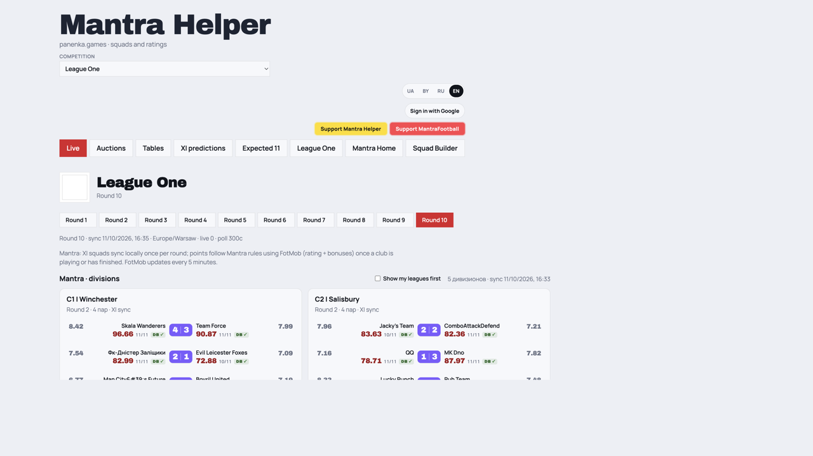
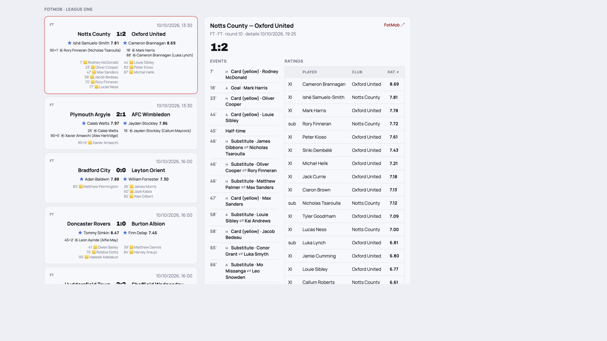
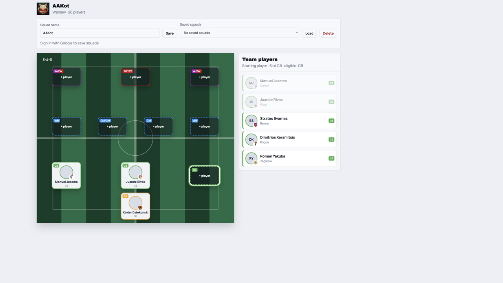
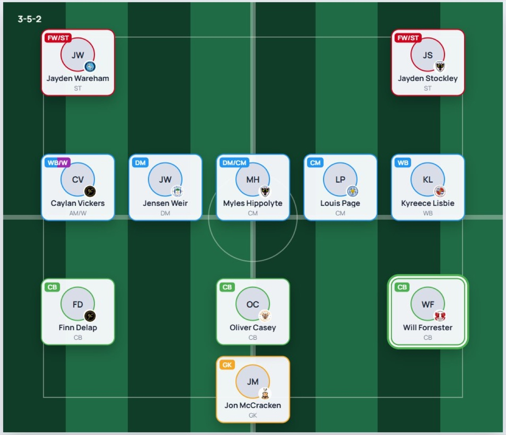
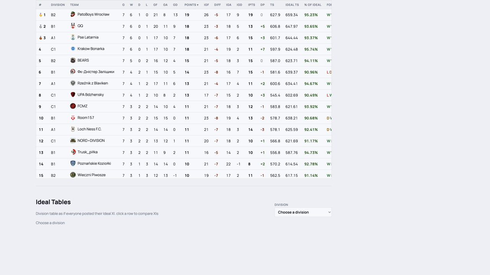
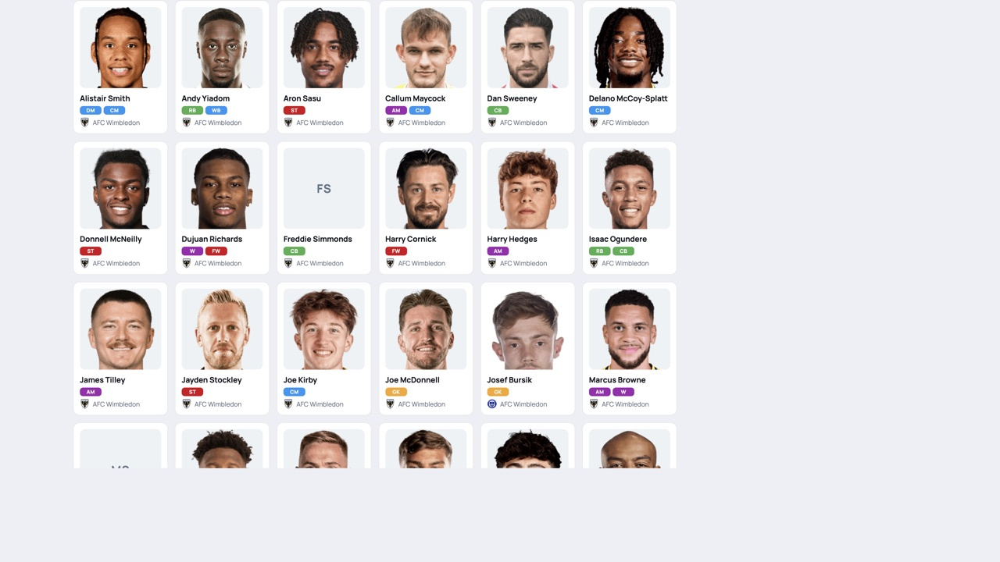
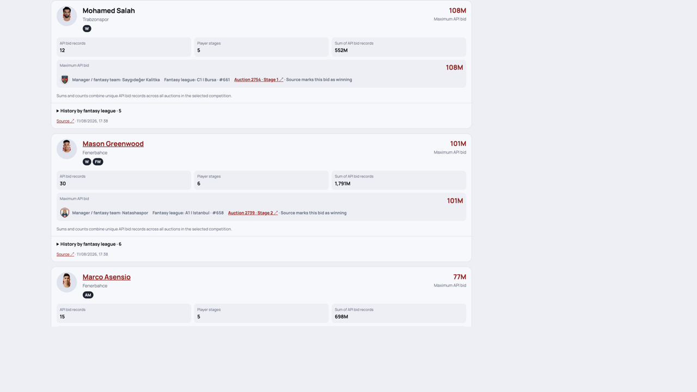
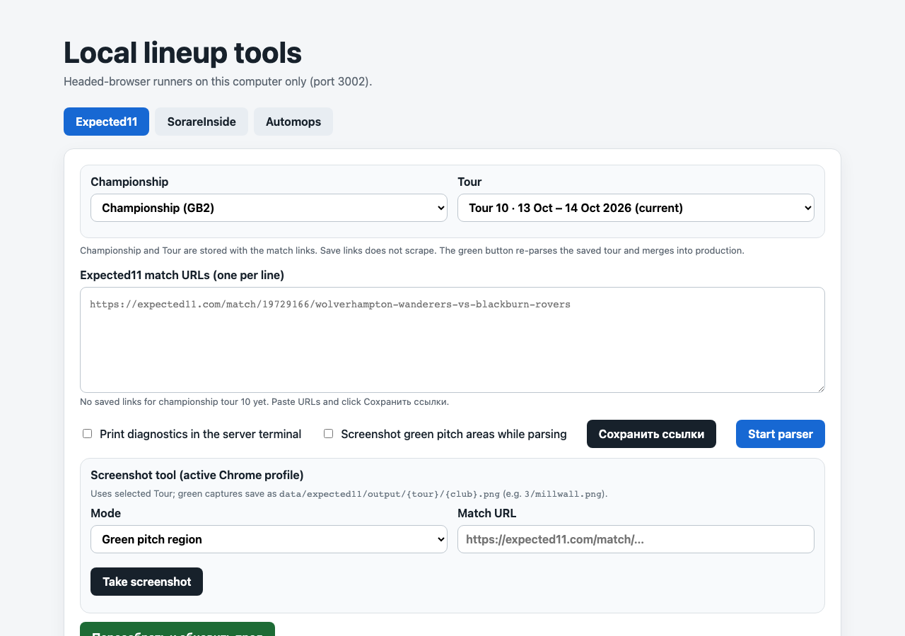
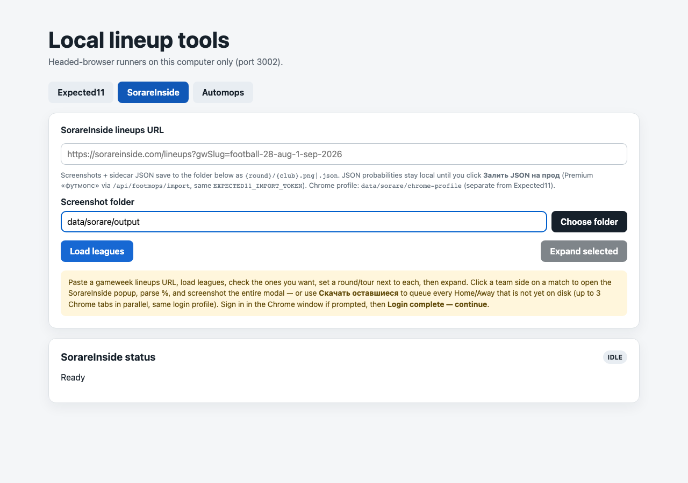

# Mantra Helper

Fantasy companion for [MantraFootball](https://mantrafootball.org): live scores, Mantra tours, a pitch XI builder, tables, auctions, and lineup intel.

**Site:** [https://mantra.panenka.games/](https://mantra.panenka.games/)

This GitHub repo is named `sorare-parser` for historical reasons. The public product is **Mantra Helper**.

Interface languages: русский, English, українська, беларуская. Sign in with Google to save squads, pin your teams, and use Premium.

---

## Screenshots

**Live** — Mantra division pairings plus FotMob match cards (goals, cards, ratings).





**Squad Builder** — pick a Mantra league and team, drop players onto a formation, export PNG.





**Tables** — combined standings with TS, Ideal TS, and % of ideal.



**Mantra Home** — player tiles for the home competition.



**Auctions** — historical bids, stages, and winning prices.



---

## English

### Who it’s for

MantraFootball managers who want one place for **today’s matches**, **this tour’s XI**, **season tables**, and **auction history** — across the same 15 leagues the builder uses.

### Features

**Public tabs:** Live · Auctions · Tables · XI predictions (`/xi`) · Expected 11 (`/sorare`, Russian label: Фейк Мопс) · League One · Mantra Home · Squad Builder.

**Gated tabs** (hidden until Google sign-in + entitlement): Premium (`/premium`) · Mapping (`/mapping`, admin) · PL Live Auction (`/live-draft`).

Also served, not in the tab bar: `/clubs`, `/players`, `/matches`, `/ref` (Transfermarkt catalog). `/` currently opens clubs.

#### Live

FotMob scores next to Mantra tour pairings. Points follow Mantra rules (rating + bonuses) once a club is playing or finished; FotMob refreshes about every 5 minutes. XI squads sync once per round.

- Round tabs, live / soon / FT cards, events, and player ratings
- Mantra division boards with pair scores, `n/11` XI, and role chips
- Dream Team of the round and Ideal vs Real
- Championship picker includes **My teams** (`Мои команды`) — your Mantra squads across leagues (Google sign-in + Mantra manager ID)
- “Show my leagues first” when you are logged in

Covered competitions (same set as Squad Builder):

Ekstraklasa · Serie A · Bundesliga · Premier League · Championship · Süper Lig · Ligue 1 · La Liga · Eredivisie · Pro League · Primeira Liga · UPL · MLS · Brasileirão · League One

League One on Live is England 3 (Mantra tournament 26): currently divisions **C1–C5** (Winchester, Salisbury, Carlisle, Hereford, Chichester). It is **not** on `/tables`.

#### Squad Builder

Build a starting XI on a green pitch using MantraFootball player photos.

- Formations (3-5-2, 4-3-3, 4-2-3-1, and the rest of the Mantra set)
- Second option on a slot (alternative)
- Download PNG
- Save / load named squads after Google sign-in
- “My teams only” filter (needs Manager ID)
- Admin: refresh squads after calculated auction rounds (30-minute cooldown per league)

#### Tables

- Combined standings across divisions: W/D/L, GF/GA, TS, **Ideal TS**, % of ideal, form
- **Managers** view — aggregated manager stats (plus extra leagues in the competition list)
- Ideal tables (everyone posted Ideal XI) vs real tables; click a row to compare XIs
- Your rows are highlighted when you are signed in with a Manager ID

#### XI predictions (`/xi`)

Public. Two modes:

- **Clubs · ideal XI** — predicted club lineups on a pitch, expert boards, bench, full roster (TM roles, Mantra positions, expert %, rating)
- **My Mantra team** — pick a Mantra league, team, tour, and formation; shows suggested XI, bench, match, and odds. Does not require login

#### Expected 11 (`/sorare`)

Imported STARTING / BENCH / OUT lineups by club (source: expected11.com). Tour and match filters. Admin can paste match URLs and rebuild (headed Chrome, same pipeline as the local parser below).

#### League One

Public **League One** tab: FotMob ↔ Transfermarkt pairing and Mantra positions.

- **Players** — link status, TM / FotMob positions, Mantra assignment
- **Reports** — scoring reports for the competition
- Admin extras: refresh, assign positions, reports sync

#### Auctions

Historical Mantra auctions: max API bid, stages, bid-record sums, winning manager. Filters, fantasy-team report, and Ideal Pick (what the other teams’ max + 1M would have bought). No login required.

#### Mantra Home (`Mantra Дома`)

Home-competition player grid (tiles or list), applicants list. Apply for a regular and/or live auction in your league (Google sign-in).

#### Logged in / Premium

Google sign-in unlocks account settings and personal filters. Premium and a few other tabs stay hidden until an entitlement is on the account.

**Any signed-in user**

- Account dialog: interface language, time zone, **Mantra Manager ID**, Sorare JWT status, SorareInside browser-import helper
- Live: **My teams**, “Show my leagues first”
- Builder: save / load / delete named squads; “My teams only”
- Tables: highlight your teams
- Mantra Home: send an auction application

**Premium** (`/premium`, entitlement `expected11Premium`)

Google sign-in plus allowlist. Direct URL without Premium redirects away.

Championships: Ekstraklasa · Serie A · Bundesliga · Premier League · Championship · Süper Lig · **League One (England 3, C1–C5)**. Tables-only leagues (Ligue 1, La Liga, …) are not in Premium.

- Squad report: minutes by tour, FotMob, TS, form 0–10 (heat), auction price, injury / ban / doubtful / OUT badges
- Top-5 unpicked players by Mantra position in that league
- Expected XI table: XI score, Expected11 %, footmops %, P(win), club CS, opponent CS
- Generate a suggested XI + bench from those signals; formation cards
- Refresh my team squad; load matches and odds
- Admin: same post-auction squad refresh as Builder (30-minute cooldown)

**Admin** (`expected11Admin`)

- **Mapping** (`/mapping`) — Expected11 ↔ Mantra player links, unmatched list, manual links
- Expected 11 ingest on `/sorare` (save URLs / rebuild)
- League One position tools and refresh
- Post-auction refresh buttons on Premium and Builder

**PL Live Auction** (`/live-draft`, entitlement `liveDraft`)

Separate board for the official Premier League live auction (budget 260, 26-player squads, nominate / bid / fold / wishlist). Tab hidden until you are on the draft list. Draft admin also gets start / stop / reset. Not the same as Mantra Home’s “I want a live auction” application.

Premium and live-draft shots are login-walled, so there are no extra screenshots here.

#### Local Expected11 parser (`http://127.0.0.1:3002/`)

Not the public site. A headed-Chrome toolbox on this computer for lineup sources that Premium and Expected 11 then show.

```bash
npm run expected11:web
```

Binds **http://127.0.0.1:3002/** (`src/expected11-server.ts`, UI in `public-expected11/`). Sign in in the Chrome window it opens (Expected11 / SorareInside email + password, not Google). No passwords are typed into this local page.

Tabs:

- **Expected11** — championship + tour, paste expected11.com match URLs, save links, parse, optional green-pitch screenshots, rebuild/merge into production
- **SorareInside** — load a gameweek lineups URL, expand leagues, capture % + screenshots, publish JSON as Premium «футмопс»
- **Automops** — dry-run preview of the Telegram channel post for a championship + tour; publish only when you click the post button





---

## Русский

### Для кого

Менеджеры MantraFootball: **лайв матчей**, **туры и XI**, **таблицы сезона** и **история аукционов** — в тех же 15 лигах, что и Squad Builder.

### Возможности

**Публичные вкладки:** Live · Аукционы · Таблицы · Предикты XI (`/xi`) · Фейк Мопс (`/sorare`, EN: Expected 11) · League One · Mantra Дома · Squad Builder.

**Закрытые вкладки** (скрыты, пока нет Google-входа + entitlement): Premium (`/premium`) · Mapping (`/mapping`, админ) · Живой аукцион АПЛ (`/live-draft`).

Есть и без вкладки: `/clubs`, `/players`, `/matches`, `/ref` (каталог Transfermarkt). `/` сейчас открывает клубы.

#### Live

Счёта FotMob рядом с парами туров Mantra. Очки считаются по правилам Mantra (рейтинг + бонусы), когда клуб уже играет или сыграл; FotMob обновляется примерно раз в 5 минут. Составы XI синкаются раз за тур.

- Вкладки туров, карточки live / soon / FT, события и оценки
- Доски дивизионов: счёт пары, `n/11` XI, чипы ролей
- Dream Team тура и Ideal vs Real
- В селекторе чемпионата есть **Мои команды** — ваши составы Mantra по всем лигам (вход Google + Mantra Manager ID)
- «Показывай мои лиги вверху» после входа

Лиги (тот же набор, что в Builder):

Ekstraklasa · Serie A · Bundesliga · Premier League · Championship · Süper Lig · Ligue 1 · La Liga · Eredivisie · Pro League · Primeira Liga · UPL · MLS · Brasileirão · League One

League One в Live — это England 3 (турнир Mantra 26): сейчас дивизионы **C1–C5** (Winchester, Salisbury, Carlisle, Hereford, Chichester). На `/tables` этой лиги **нет**.

#### Squad Builder

Стартовый XI на зелёном поле с фото игроков MantraFootball.

- Схемы (3-5-2, 4-3-3, 4-2-3-1 и остальные схемы Mantra)
- Вторая опция на слот
- Скачать PNG
- Сохранение составов после входа через Google
- Фильтр «Только мои команды» (нужен Manager ID)
- Админ: обновление составов после рассчитанных раундов аукциона (кулдаун 30 минут на лигу)

#### Таблицы

- Сводная таблица по дивизионам: W/D/L, GF/GA, TS, **Ideal TS**, % к идеалу, форма
- Вид **Managers** — статистика менеджеров (в списке чемпионатов есть дополнительные лиги)
- Идеальные таблицы (все выставили Ideal XI) и реальные; клик по строке — сравнение XI
- Свои строки подсвечиваются, если вы вошли и указали Manager ID

#### Предикты XI (`/xi`)

Публичная вкладка. Два режима:

- **Клубы · идеальный XI** — прогноз составов клубов на поле, доски экспертов, запас, ростер (роли TM, позиции Mantra, % экспертов, рейтинг)
- **Моя команда Mantra** — лига, команда, тур и схема; предлагаемый XI, скамейка, матч и коэффициенты. Вход не обязателен

#### Фейк Мопс (`/sorare`)

Импортированные составы STARTING / BENCH / OUT по клубам (источник: expected11.com). Фильтры тура и матча. Админ может вставить ссылки матчей и пересобрать (headed Chrome, тот же пайплайн, что у локального парсера ниже).

#### League One

Публичная вкладка **League One**: связка FotMob ↔ Transfermarkt и позиции Mantra.

- **Игроки** — статус связи, позиции TM / FotMob, назначение Mantra
- **Отчёты** — отчёты по чемпионату
- Админ: обновление, назначение позиций, синк отчётов

#### Аукционы

История аукционов Mantra: максимальная ставка API, этапы, сумма записей, победитель. Фильтры, отчёт по фэнтези-команде и Ideal Pick (максимум остальных + 1M). Вход не нужен.

#### Mantra Дома

Сетка игроков домашней лиги (плитки или список), список заявившихся. Заявка на обычный и/или живой аукцион (вход Google).

#### Вход / Premium

Google-вход открывает настройки аккаунта и личные фильтры. Вкладки Premium и ещё несколько остаются скрытыми, пока на аккаунте нет entitlement.

**Любой залогиненный**

- Диалог аккаунта: язык, часовой пояс, **Mantra Manager ID**, статус Sorare JWT, импорт SorareInside из браузера
- Live: **Мои команды**, «Показывай мои лиги вверху»
- Builder: сохранить / загрузить / удалить составы; «Только мои команды»
- Таблицы: подсветка своих команд
- Mantra Дома: заявка на аукцион

**Premium** (`/premium`, entitlement `expected11Premium`)

Google-вход плюс allowlist. Прямой URL без Premium уводит со страницы.

Чемпионаты: Ekstraklasa · Serie A · Bundesliga · Premier League · Championship · Süper Lig · **League One (England 3, C1–C5)**. Лиги только из таблиц (Ligue 1, La Liga, …) в Premium не входят.

- Отчёт по составу: минуты по турам, FotMob, TS, форма 0–10, цена с аукциона, бейджи травма / дисквал / сомнителен / OUT
- Топ-5 невзятых игроков по позициям Mantra в лиге
- Таблица Expected XI: оценка, Expected11 %, футмопс %, P(win), CS клуба, CS соперника
- Генерация XI + скамейки по этим сигналам; карточки схем
- Обновить состав моей команды; подгрузить матчи и коэффициенты
- Админ: то же обновление после аукциона, что в Builder (кулдаун 30 минут)

**Админ** (`expected11Admin`)

- **Mapping** (`/mapping`) — связи Expected11 ↔ Mantra, несвязанные, ручные связи
- Разбор Expected11 на `/sorare` (сохранить ссылки / пересобрать)
- Инструменты позиций и обновление League One
- Кнопки обновления после аукциона в Premium и Builder

**Живой аукцион АПЛ** (`/live-draft`, entitlement `liveDraft`)

Отдельная доска официального live-аукциона АПЛ (бюджет 260, составы 26 игроков, номинация / ставка / пас / вишлист). Вкладка скрыта, пока вас нет в списке драфта. У админа драфта ещё start / stop / reset. Это не заявка «Хочу живой аукцион» на Mantra Дома.

Скриншотов Premium и драфта нет: они за логином.

#### Локальный парсер Expected11 (`http://127.0.0.1:3002/`)

Не публичный сайт. Headed-Chrome инструменты на этом компьютере для источников составов, которые потом видят Premium и Фейк Мопс.

```bash
npm run expected11:web
```

Слушает **http://127.0.0.1:3002/** (`src/expected11-server.ts`, UI в `public-expected11/`). Логин — в окне Chrome, которое открывает парсер (email и пароль Expected11 / SorareInside, не Google). Пароли в эту локальную страницу не вводятся.

Вкладки:

- **Expected11** — чемпионат + тур, ссылки expected11.com, сохранить, разобрать, опционально скрины зелёного поля, пересобрать/влить в прод
- **SorareInside** — URL туров lineups, раскрыть лиги, снять % + скрины, залить JSON как Premium «футмопс»
- **Automops** — превью поста в Telegram для чемпионата + тура; в канал уходит только по кнопке публикации


---

## Local development

Node.js, npm. Copy `.env.example` → `.env` and fill only what you need (API keys stay local; do not commit `.env`).

```bash
npm install
npm test
npm run dev:tm
```

`dev:tm` serves the Mantra Helper UI (the same app as production). Default port is `3000`.

Optional local tools still in this repo:

- `npm run expected11:web` — Expected11 / SorareInside / Automops parser UI on `http://127.0.0.1:3002` (not the public site; see the parser subsection above)
- `npm run sync:mantra`, `npm run sync:live`, and other `sync:*` scripts — data ingest for leagues the site already shows
